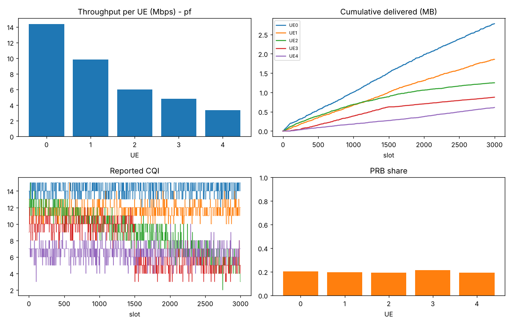

# single-cell-gnb-scheduler-sim

A small, readable **5G NR MAC scheduler simulator**: one gNB cell, five UEs, simulated slot by slot in the downlink.
It also includes a **MAC PDU / control element library** (DL and UL, byte-exact, plus the random access response),
an **uplink scheduling demo** and a **random access (RACH) demo** built on it.

Compare the classic MAC schedulers (Round Robin, Max-CQI, Proportional Fair) under a realistic MAC/PHY
abstraction, and watch a rule-based **agent** spot problems such as starving users, explain them in plain
language with document citations, and apply one safe fix at a time.

Who it's for: engineers and students who want to *see* the throughput-vs-fairness trade-off of NR scheduling,
who want a compact example of an "explain, then act, then verify" agent wrapped around a simulator, or who need
readable Python to encode and decode NR MAC PDUs.

**Jump to:** [Quick start](#quick-start) · [Results](#results) · [The agent](#the-agent) ·
[MAC PDU and CE library](#mac-pdu-and-ce-library) · [Uplink demo](#uplink-demo) · [Random access demo](#random-access-demo) ·
[Configuration](#configuration) ·
[Limitations](#limitations)


## Highlights

- **Three schedulers behind one interface:** Round Robin, Max-CQI and Proportional Fair, plus per-UE weights.
- **MAC/PHY abstraction:** numerology, PRBs, CQI → MCS → TBS (3GPP TS 38.214 tables), HARQ with retransmissions,
  logistic BLER, delayed CQI and BSR reports, and optional outer-loop link adaptation (OLLA).
- **An explaining agent:** every 10 slots it checks the last 100 against plain rules, looks up *why* in a
  knowledge base, writes an explanation with file and page citations, and applies at most one action. Each
  action has a cooldown and bounds, and is rolled back if it doesn't help.
- **MAC PDU / CE library:** pack and unpack DL-SCH and UL-SCH MAC PDUs (TS 38.321) with 18 typed control elements,
  including TA, SCell activation, DRX, BSR, PHR and C-RNTI.
- **Uplink demo:** SR → grant → BSR → sized grant → HARQ, exchanging real MAC PDUs, with the full TS 38.214 TBS.
- **Random access demo:** 4-step contention-based RACH (preamble → RAR → Msg3 → contention resolution) with
  preamble collisions, backoff and retries, plus contention-free RA started by a PDCCH order (dedicated preamble,
  done at the RAR). RAR PDUs and PDCCH-order DCIs are built and parsed byte-exact.
- **Deterministic and tested:** the same seed gives identical logs, and 411 tests run in about 1 s.

## Quick start

Requires Python 3.10 or newer.

```bash
git clone https://github.com/vijaiks/single-cell-gnb-scheduler-sim
cd single-cell-gnb-scheduler-sim
python -m venv .venv && source .venv/bin/activate
pip install -e ".[dev]"            # numpy, PyYAML, matplotlib, pytest
pytest -q                          # 411 tests, ~1 s

python -m gnbsim compare   configs/mixed5_l1.yaml      # RR vs Max-CQI vs PF: table + plot
python -m gnbsim run       configs/mixed5_l2.yaml      # realistic MAC/PHY: HARQ, BLER, delayed reports
python -m gnbsim agent-run configs/mixed5_agent.yaml   # the agent starts on Max-CQI and reacts
python -m gnbsim run configs/mixed5_agent.yaml --no-agent --algo maxcqi   # the same scenario without the agent

python -m gnbsim.ul_sim            # uplink demo: prints a slot-by-slot trace
python -m gnbsim.rach_sim          # random access demo: collision, PDCCH order (CFRA), load tests
```

Each run writes `runs/<config>_<algo>_<seed>/` containing `summary.json`, `slots.csv` (one row per slot),
`config.yaml` (the resolved config) and `plots.png`. Agent runs also write `agent_log.jsonl`. Sample outputs
are in [`examples/`](examples/). These commands also accept `--slots`, `--seed` and `--out`; the uplink and random
access demos take no options and only print.

## Three levels of realism, one code base

The same engine runs at three levels, selected purely by config. (These are *simulation levels*, not the
3GPP protocol layers L1/L2/L3.)

| Level | Config file | What changes |
|---|---|---|
| 1 · Basic | `mixed5_l1.yaml` | 1 UE per slot, no HARQ or BLER, perfect CQI and BSR every slot |
| 2 · Realistic | `mixed5_l2.yaml` | 2 UEs per slot sharing PRBs, HARQ + logistic BLER, CQI every 5 slots (2-slot delay), BSR every 10, optional OLLA |
| 3 · Agent | `mixed5_agent.yaml` | Level 2 plus `agent: {enabled: true}` |

## Results

**Level 1, 2000 slots, seed 1** (`python -m gnbsim compare configs/mixed5_l1.yaml`):

| Scheduler | Cell Mbps | Jain (throughput) | Jain (PRB share) | Notes |
|---|---|---|---|---|
| Round Robin | 22.19 | 0.819 | 1.000 | equal airtime |
| Max-CQI | 39.06 | 0.202 | 0.202 | UE 1–4 starved: UE 0 gets almost everything |
| Proportional Fair | 26.18 | 0.831 | 0.997 | best balance |

**Agent vs no agent, 3000 slots, seed 1** (`mixed5_agent.yaml`). The run starts on Max-CQI, and UE 3 is hit
by −10 dB of interference at slot 1500.

| Run | Cell Mbps | Jain (throughput) | Jain (PRB share) | Starved UEs | Weakest UE |
|---|---|---|---|---|---|
| Max-CQI, no agent | 57.40 | 0.434 | 0.486 | 3 | 0.22 Mbps |
| With agent | 38.39 | 0.788 | 0.999 | 0 | 3.36 Mbps |

The agent sees two starving UEs at slot 100 and switches to PF. Over the rest of the run it lowers the MCS for
UEs with high BLER, raises the scheduling weight of UEs that start to starve, and flags the interference on
UE 3. Every action was checked 100 slots later and kept. Fairness costs about a third of cell throughput,
which is the expected trade-off.



## Terms used

| Term | Meaning |
|---|---|
| **PRB** | Physical Resource Block, the unit of bandwidth the scheduler hands out (50 per slot here). |
| **CQI** | Channel Quality Indicator (1–15) reported by the UE. Higher means a better channel. |
| **MCS** | Modulation and Coding Scheme (0–27) picked from CQI. Higher means more bits per PRB. |
| **TBS** | Transport Block Size: the bits carried in one grant, set by MCS and the number of PRBs. |
| **BLER** | Block Error Rate: the fraction of first transmissions that fail. The usual target is about 10%. |
| **HARQ** | Hybrid ARQ: fast retransmission of failed blocks. |
| **BSR** | Buffer Status Report: how much data a UE has waiting. |
| **SR** | Scheduling Request: the UE's "I have data to send" signal when it has no uplink grant. |
| **PHR** | Power Headroom Report: how much transmit power the UE has left. |
| **MAC PDU** | The bytes carried in one transport block: a sequence of subPDUs (SDUs, CEs, padding). |
| **MAC CE** | MAC Control Element: a short control message inside a MAC PDU, such as a BSR or timing advance. |
| **LCID** | Logical Channel ID in each subheader: says which channel or CE follows. Meanings differ in DL and UL. |
| **LCG** | Logical Channel Group (0–7): the unit a BSR reports on. |
| **RACH** | Random access: how a UE without a C-RNTI gets one (preamble, RAR, Msg3, Msg4). |
| **RAR** | Random Access Response (Msg2): timing advance, Msg3 grant and temporary C-RNTI per detected preamble. |
| **RA-RNTI** | The identifier a RAR is addressed to, derived from the PRACH occasion the preamble used. |
| **BI** | Backoff Indicator in the RAR: the maximum random wait before a UE retries. |
| **CBRA / CFRA** | Contention-based RA (random preamble, may collide) / contention-free RA (preamble reserved for one UE). |
| **PDCCH order** | A DCI 1_0 on a UE's C-RNTI telling it to do random access, with a dedicated preamble or 0 for CBRA. |
| **OLLA** | Outer-Loop Link Adaptation: nudges MCS up or down to hold BLER near its target. |
| **Jain index** | Fairness from 0.2 (one of 5 UEs gets everything) to 1.0 (all equal). Computed on throughput and on PRB share. |
| **Starved** | A UE with data waiting that gets under half its fair PRB share, or no PRBs for 100 slots in a row. |

## The agent

The agent runs **inside the simulation**, not on a finished log. The engine calls it at the end of every
`interval` slots (10 by default), and any action it takes changes the rest of the same run from the next slot.

```
slot loop (engine) ──every 10 slots──► agent.step(t)
                                        1. verify the previous action (keep / roll back)
                                        2. analyze the last 100 slots → findings
                                        3. explain new findings (kb → citations)
                                        4. act: at most one action, applied from slot t+1
```

1. **Verify**: once an action has run for `analysis_window` slots (100 by default), compare before and after.
   Keep it if its target improved. Roll it back if it didn't improve after two checks, or if cell throughput
   fell more than the allowed limit.
2. **Analyze** the last `analysis_window` slots with plain rules: `STARVATION`, `CQI_DROP`, `HIGH_BLER`,
   `LOW_BLER`, `HARQ_EXHAUSTED`, `QUEUE_GROWING`, `LOW_FAIRNESS`, `PRB_UNDERUSE`.
3. **Explain**: query the knowledge base for each new finding and write a plain-language explanation with the
   numbers and a file/page citation.
4. **Act**: apply at most one action from a fixed menu: `SWITCH_ALGO`, `RAISE_WEIGHT`, `ADJUST_MCS_OFFSET`,
   `SET_TC`, `RAISE_MAX_UES`. `FLAG_*` actions are advice only. Actions honour a cooldown and bounds, and no
   new action starts while an earlier one is still being verified.

Decisions and verification use only the simulator's own measurements. The knowledge base supplies the
explanations. Everything is logged to `agent_log.jsonl`: findings, explanations, citations, actions and verdicts.

### Knowledge base (optional)

The agent needs no external service. Choose the source of explanations with `agent.kb`:

| `kb:` | What it does |
|---|---|
| `stub` (default) | Built-in short snippets. Works offline. |
| `cached` | Reads and records answers in a JSONL file (`kb_cache`). |
| `command` | Runs `kb_command "<query>" "<technology>"`, which must print JSON `[{"file", "page", "text"}, ...]`. |

The KB affects only the explanations, never the decisions: stub and live runs give identical results.

> **About the citations:** file and page references point to the author's personal PDF library, so you
> won't be able to open them. To cite your own documents, use `kb-rag` below.

**Using kb-rag.** [kb-rag](https://github.com/vijaiks/kb-rag) is a local retrieval system (RAG) over your own
PDFs: hybrid vector and keyword search with reranking, returning chunks cited by file and page.
[`tools/kb_rag_search.py`](tools/kb_rag_search.py) wraps its retrieval as a command that prints JSON. It runs
inside kb-rag's own virtualenv, so this project needs no extra dependencies.

```bash
export KB_RAG_HOME=/path/to/kb-rag                              # your kb-rag checkout, already indexed
python tools/kb_rag_search.py "HARQ round trip time" NR         # one query (~45 s: model load)
python tools/kb_rag_search.py --prefetch kb_cache.jsonl         # all 8 agent queries in one go (~45 s)
python -m gnbsim agent-run configs/mixed5_agent_kb.yaml         # kb: command, reading kb_cache.jsonl first
```

Cache misses call the wrapper. Failed lookups are never cached, and the agent carries on without citations.
`kb_cache.jsonl` is git-ignored because it holds text copied from your own documents.

## MAC PDU and CE library

[`macpdu.py`](src/gnbsim/macpdu.py) packs and unpacks whole MAC PDUs; [`macce.py`](src/gnbsim/macce.py) has one class
per control element. It uses only the Python standard library and can be used without the simulator.

**Downlink:** 100-byte transport block, CEs first, then SDUs, then padding.

```python
from gnbsim.macce import TACommand, SCellActivation
from gnbsim.macpdu import DL, MacSdu, pack, unpack

tb = pack([TACommand(tag_id=0, ta=33),      # 3d 21
           SCellActivation({1, 2}),         # 3a 06
           MacSdu(1, bytes(20)),            # 01 14 + 20 bytes (SRB1)
           MacSdu(4, bytes(60))],           # 04 3c + 60 bytes (DRB)
          tb_bytes=100, direction=DL)       # 3f + 11 bytes of padding
unpack(tb, DL)                              # the same objects, plus Padding(11)
```

**Uplink:** SDUs first, then CEs, then padding.

```python
from gnbsim.macce import ShortBSR, SingleEntryPHR
from gnbsim.macpdu import UL, MacSdu, pack, unpack

tb = pack([MacSdu(4, b"hello"),
           ShortBSR.from_bytes(lcg=2, n_bytes=3000),   # 3d 53
           SingleEntryPHR(ph=40, pcmax=50)],           # 39 28 32
          tb_bytes=20, direction=UL)
unpack(tb, UL)[1].n_bytes()                            # 3909: the BSR level that covers 3000 bytes
```

| Direction | Control elements (LCID) |
|---|---|
| DL | Recommended bit rate (47), duplication activation (56), SCell activation 4-octet (57) and 1-octet (58), long DRX command (59), DRX command (60), timing advance (61), contention resolution (62) |
| DL, raw bytes only | Beam and CSI activation CEs (48–55) |
| UL | Bit rate query (53), multi-entry PHR 4-octet (54) and 1-octet (56), configured grant confirmation (55), single-entry PHR (57), C-RNTI (58), short truncated BSR (59), long truncated BSR (60), short BSR (61), long BSR (62) |

Also included: `build_tb` (fill a block from RLC queues), `dispatch` (route SDUs and CEs), and `regular_bsr` /
`padding_bsr` (pick the BSR format). Truncated PDUs, bad field values and unsupported LCIDs raise `MacPduError`.

**Random access response** ([`rar.py`](src/gnbsim/rar.py), TS 38.321 §6.1.5, §6.2.2–6.2.3): the RAR PDU has its own
format (E/T subheaders, 7-byte MAC RAR with TA, 27-bit UL grant and temporary C-RNTI), so it has its own builder and parser.

```python
from gnbsim.rar import RarEntry, build_rar_pdu, pack_ul_grant, parse_rar_pdu, ra_rnti

grant = pack_ul_grant(hop=0, freq=0x123, time=2, mcs=4, tpc=3, csi=0)   # 27-bit Msg3 grant (TS 38.213 Table 8.2-1)
pdu = build_rar_pdu([RarEntry(rapid=7, ta=100, grant=grant, tc_rnti=0x4601)], bi_idx=2)
# 82 47 03 20 12 32 46 46 01 : BI subPDU (E=1, 20 ms), then last subPDU: RAPID 7 + MAC RAR
parse_rar_pdu(pdu)                 # (2, [RarEntry(rapid=7, ta=100, ...)])
ra_rnti(s_id=0, t_id=20, f_id=0)   # 281
```

## Uplink demo

In the uplink the data is in the UE but the gNB decides who sends, so the two exchange real MAC PDUs:

```
UE                                            gNB
 │── SR: "I have data" ────────────────────►
 │◄─ DCI: small grant ──────────────────────
 │── PUSCH: some data + BSR ───────────────►  unpack, estimate the UE's buffer
 │◄─ DCI: grant sized from the BSR ─────────  fewest PRBs whose TBS fits
 │── PUSCH: the remaining data ────────────►  CRC failure → HARQ retransmission
```

`python -m gnbsim.ul_sim` runs two UEs, with one forced CRC failure. Part of its output:

```
[slot   0] UE0 3000B arrive on LCID 4
[slot   1] UE0 sends SR
[slot   3] gNB DCI UE0 pid0 NDI1 (new) 63B (2 PRB) -> PUSCH slot 7
[slot   7] UE0 PUSCH pid0 TB#0 63B attempt 0
[slot   9] gNB UE0 ShortBSR = 3909B, already granted later 0B -> est 3909B
[slot   9] gNB DCI UE0 pid0 NDI0 (new) 3329B (106 PRB) -> PUSCH slot 13
...
[slot  15] gNB UE0 pid0 CRC fail -> retx needed
[slot  15] gNB DCI UE0 pid0 NDI0 (same) RV2 3329B -> PUSCH slot 19
...
UE0: injected 3000 B, delivered 3000 B, completed at slot 21
UE1: injected 1500 B, delivered 1500 B, completed at slot 39
```

The demo is separate from the downlink engine and the agent: it does not use the YAML configs or change their results.
Grant sizing ([`ulgrant.py`](src/gnbsim/ulgrant.py)) uses the full TS 38.214 TBS calculation.

## Random access demo

Before a UE can be scheduled it must get a C-RNTI through random access. Two UEs that pick the same preamble get
the same RAR and send Msg3 on the same temporary C-RNTI; Msg4 echoes the identity of the one the gNB decoded, and
the other UE backs off and tries again:

```
UE                                              gNB
 │── Msg1: preamble (PRACH occasion) ────────►  detect preambles, measure TA
 │◄─ Msg2: RAR on RA-RNTI (BI, RAPID, TA, ───  one MAC RAR per detected preamble
 │        UL grant, temporary C-RNTI)
 │── Msg3: UL CCCH SDU (48-bit identity) ────►  unpack the MAC PDU
 │◄─ Msg4: Contention Resolution CE ─────────  echoes the identity it decoded
 │   match → C-RNTI    no match / timer → backoff (0..BI), new preamble, up to preambleTransMax
```

`python -m gnbsim.rach_sim` first runs three UEs where UE0 and UE1 collide on preamble 23. Part of its output:

```
[slot  24 |   12.0 ms] gNB RAR on RA-RNTI 1: RAPIDs [7, 23], 17 B: 82 c7 00 50 10 72 46 46 01 57 00 d8 11 72 46 46 02
[slot  30 |   15.0 ms] UE0 Msg3 on TC-RNTI 0x4602: 34 78 9b 34 ca f5 4f 3f 00 00 00
[slot  30 |   15.0 ms] UE1 Msg3 on TC-RNTI 0x4602: 34 22 0a cd 94 1e 71 3f 00 00 00
[slot  31 |   15.5 ms] gNB sees 2 UEs transmitting Msg3 on TC-RNTI 0x4602 (collision)
[slot  31 |   15.5 ms] gNB decoded Msg3, Msg4 on TC-RNTI 0x4602 echoes 220acd941e71: 3e 22 0a cd 94 1e 71 3f 00 ...
[slot  35 |   17.5 ms] UE0 contention resolution identity does not match, lost the contention
[slot  35 |   17.5 ms] UE0 backoff 11.5 ms (PREAMBLE_BACKOFF 20 ms), then new preamble
[slot  35 |   17.5 ms] UE1 contention resolution OK, TC-RNTI 0x4602 becomes its C-RNTI
...
[slot  75 |   37.5 ms] UE0 contention resolution OK, TC-RNTI 0x4603 becomes its C-RNTI
```

Msg3 is a real UL MAC PDU (`34` = UL CCCH, LCID 52, no length field) and Msg4 a real DL MAC PDU (`3e` = contention
resolution CE, LCID 62), both built with the MAC library.

### Contention-free random access (PDCCH order)

A connected UE that has lost uplink sync (for example, its timing alignment timer expired while the gNB has downlink
data for it) is told to do random access by a **PDCCH order**: a DCI format 1_0 on its C-RNTI whose frequency field is
all ones ([`dci.py`](src/gnbsim/dci.py), TS 38.212 §7.3.1.2.1). The order carries a **dedicated preamble**, so no other
UE can send it and there is nothing to resolve:

```
UE (has C-RNTI)                                 gNB
 │◄─ PDCCH order (DCI 1_0 on C-RNTI) ─────────  reserves a dedicated preamble (56..63)
 │── Msg1: dedicated preamble ───────────────►  knows exactly which UE sent it
 │◄─ Msg2: RAR with its RAPID, TA ────────────  releases the preamble
 │   done: applies the TA, keeps its C-RNTI (no Msg3 / Msg4)
```

Preambles 0–55 are contention-based and 56–63 are reserved (`Cfg.num_cb_preambles`). If no RAR arrives, a CFRA UE
retries at the next occasion without backoff. If all dedicated preambles are in use, the order carries preamble
index 0 and the UE does CBRA as a **connected** UE: Msg3 holds a C-RNTI MAC CE (`3a` = LCID 58) instead of a CCCH
SDU, and contention is resolved by a PDCCH addressed to its C-RNTI instead of a Contention Resolution CE.

Example 2 of the demo: idle UE0 starts CBRA and connected UE1 gets a PDCCH order, both using the same occasion:

```
[slot   5 |    2.5 ms] gNB PDCCH order to UE1 on C-RNTI 0x1002: preamble index 56, DCI 1_0 ff fe 00 00 00
[slot  20 |   10.0 ms] UE0 Msg1 preamble 34, attempt 1
[slot  20 |   10.0 ms] UE1 Msg1 preamble 56, attempt 1
[slot  24 |   12.0 ms] gNB RAR on RA-RNTI 1: RAPIDs [34, 56], 17 B: 82 e2 00 d8 12 22 46 46 01 78 04 48 13 82 46 46 02
[slot  24 |   12.0 ms] UE1 RAR matched dedicated RAPID 56: TA=137, CFRA complete, keeps C-RNTI 0x1002 (TC-RNTI 0x4602 ignored, no Msg3/Msg4)
[slot  30 |   15.0 ms] UE0 Msg3 on TC-RNTI 0x4601: 34 78 9b 34 ca f5 4f 3f 00 00 00
[slot  35 |   17.5 ms] UE0 contention resolution OK, TC-RNTI 0x4601 becomes its C-RNTI
```

The demo ends with two load tests: 40 CBRA UEs starting within 8 ms, and a mix of 30 CBRA UEs and 10 PDCCH orders
competing for 8 dedicated preambles, with the results split by kind:

```
UEs 40: success 40, failed 0, preamble collisions 3
  cbra           UEs 30  success 30  setup ms: mean 25.4, median 17.0, max 67.0  attempts {1: 19, 2: 9, 3: 2}
  cfra           UEs  8  success  8  setup ms: mean 14.8, median 19.0, max 21.5  attempts {1: 4, 2: 4}
  cfra_fallback  UEs  2  success  2  setup ms: mean 11.0, median 12.0, max 12.0  attempts {1: 2}
```

Setup time counts from the trigger (CBRA) or from the PDCCH order (CFRA), so much of it is waiting for the next
PRACH occasion (every 10 ms). Once its preamble is sent, a CFRA UE is done 2 ms later at the RAR, and a CBRA UE 7.5 ms
later at Msg4 if nothing collides. Half the CFRA UEs here needed a second attempt because their preamble was not
detected (20% miss chance on the first try); none of them collided. Like the uplink demo, the random access demo is
separate from the downlink engine.

## Configuration

Configs are YAML files. Every key and its default is defined in [`src/gnbsim/config.py`](src/gnbsim/config.py).
The main groups are:

| Key | Purpose |
|---|---|
| `slots`, `seed`, `mu`, `n_prb` | Run length, random seed, numerology (slot length), cell bandwidth in PRBs |
| `max_ues_per_slot` | UEs scheduled for new data per slot (retransmissions come on top) |
| `algo: {name, params}` | `rr`, `maxcqi` or `pf` (`params.tc`: PF averaging window) |
| `phy` | HARQ (`k1`, `n_harq`, `max_retx`), `bler_model`, OLLA, MIMO `layers` |
| `reports` | CQI period and delay (`p_cqi`, `d_cqi`), BSR period (`p_bsr`) |
| `metrics` | Warm-up slots excluded from results, starvation threshold |
| `agent` | `enabled`, `interval`, `analysis_window`, `kb`, `kb_cache`, `kb_command`, rule thresholds |
| `ues[]` | Per UE: `priority`; `channel` (mean SINR, noise, ramp, shadowing, timed `events`); `traffic` (`full_buffer`, `poisson`, `periodic`) |

## Project layout

```
src/gnbsim/
  engine.py      slot loop: reports → scheduling → PRB allocation → HARQ / BLER → metrics
  schedulers/    rr.py, maxcqi.py, pf.py behind base.py
  allocator.py   splits PRBs among the UEs picked for the slot
  phy.py         CQI → MCS → TBS, BLER model              tables.py  3GPP TS 38.214 tables
  macpdu.py      pack / unpack DL and UL MAC PDUs         macce.py  DL / UL MAC control elements (BSR, PHR, TA, ...)
  bsr_tables.py  TS 38.321 buffer size levels             ulgrant.py  full TS 38.214 TBS, BSR -> PRB grant sizing
  ul_sim.py      standalone UL loop using the MAC PDU library (`python -m gnbsim.ul_sim`); separate from the DL engine
  rar.py         RAR PDU build / parse, RA-RNTI, Msg3 UL grant   dci.py  PDCCH order (DCI 1_0) encode / decode
  rach_sim.py    standalone random access demo, CBRA and CFRA (`python -m gnbsim.rach_sim`); separate from the DL engine
  harq.py        HARQ processes and retransmissions       numerology.py  slot timing per μ
  channel.py     synthetic SINR traces                    traffic.py  full-buffer / Poisson / periodic
  ue.py          per-UE state, OLLA offset                metrics.py  per-slot log, summaries, Jain index
  agent/         analyzer + findings (detect), kb + explainer (explain), actions (act), loop (verify)
  config.py      config schema   cli.py  command line    plots.py  figures
tools/           kb_rag_search.py: kb-rag command-line wrapper
configs/         mixed5_l1, mixed5_l2, mixed5_agent, mixed5_agent_kb, demo_100slots
tests/           PHY, HARQ, traffic, MAC PDU / CE, RAR, PDCCH order, random access, uplink, allocator, schedulers,
                 engine invariants, scenarios, agent
docs/design/     design document (PDF) and Graphviz sources for its diagrams
examples/        sample outputs: scheduler comparison, agent run
```

The [design document](docs/design/design_v0.3.pdf) covers the architecture, the slot timeline, the HARQ and
link-adaptation models, and the agent design, with diagrams.

## Limitations

- One cell, downlink only (`ul_sim.py` is a separate uplink demo), no inter-cell interference model, no mobility beyond scripted SINR ramps and events.
- SINR traces are synthetic, and the BLER curve is an abstraction that is not calibrated to a real network.
- Simplified TBS in the downlink engine: `156 RE/PRB × Qm × R × layers`, without the full TS 38.214 §5.1.3.2 quantisation. It is
  within 1% of the known maximum NR TBS (319,784 bits: 275 PRBs, 256QAM, R = 948/1024).
- `max_ues_per_slot` caps UEs that get new data. Retransmissions are extra, with one grant per UE per slot.
- MAC library: no eLCID or newer Rel-16+ CEs and no type-2 PHR; PHR values are raw indices, not dB. The CE layouts
  were not tested against real equipment.
- Uplink demo: fixed MCS, strict priority between channels, no power control or DRX, no RLC retransmission.
- Random access demo: 4-step CBRA and PDCCH-order CFRA only (no handover or beam-failure CFRA, no 2-step RA, no
  SI-request RAPID-only subPDU), one SSB and PRACH mask index 0,
  no power ramping (detection probability rises per attempt instead), no HARQ on Msg3/Msg4, fixed Msg3 size,
  Msg4 without RRCSetup, one PRACH occasion every 10 ms.
- The agent is rule-based: no learning, fixed thresholds, and one action per window.

## License

MIT, see [LICENSE](LICENSE).
