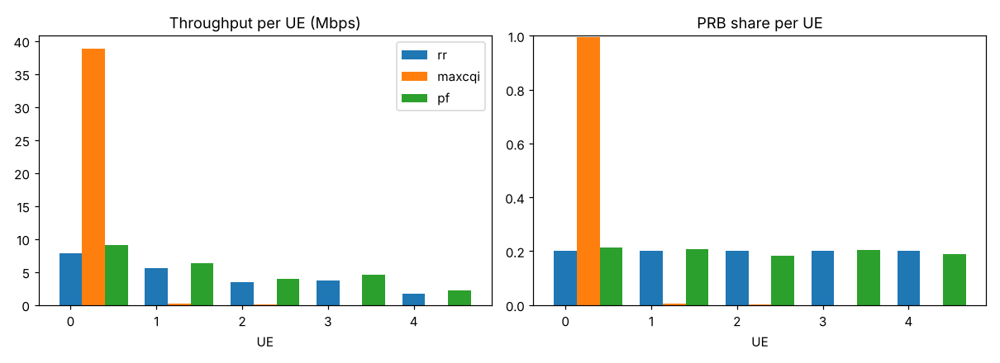

# single-cell-gnb-scheduler-sim

A small, readable **5G NR downlink scheduler simulator**: one gNB cell, five UEs, simulated slot by slot.
Compare the classic MAC schedulers (Round Robin, Max-CQI, Proportional Fair) under a realistic MAC/PHY
abstraction, and watch a rule-based **agent** spot problems such as starving users, explain them in plain
language with document citations, and apply one safe fix at a time.

Who it's for: engineers and students who want to *see* the throughput-vs-fairness trade-off of NR scheduling,
or who want a compact example of an "explain, then act, then verify" agent wrapped around a simulator.



## Highlights

- **Three schedulers behind one interface:** Round Robin, Max-CQI and Proportional Fair, plus per-UE weights.
- **MAC/PHY abstraction:** numerology, PRBs, CQI → MCS → TBS (3GPP TS 38.214 tables), HARQ with retransmissions,
  logistic BLER, delayed CQI and BSR reports, and optional outer-loop link adaptation (OLLA).
- **An explaining agent:** every 10 slots it checks the last 100 against plain rules, looks up *why* in a
  knowledge base, writes an explanation with file and page citations, and applies at most one action. Each
  action has a cooldown and bounds, and is rolled back if it doesn't help.
- **Deterministic and tested:** the same seed gives identical logs, and 52 tests run in about 1 s.

## Quick start

Requires Python 3.10 or newer.

```bash
git clone https://github.com/vijaiks/single-cell-gnb-scheduler-sim
cd single-cell-gnb-scheduler-sim
python -m venv .venv && source .venv/bin/activate
pip install -e ".[dev]"            # numpy, PyYAML, matplotlib, pytest
pytest -q                          # 52 tests, ~1 s

python -m gnbsim compare   configs/mixed5_l1.yaml      # RR vs Max-CQI vs PF: table + plot
python -m gnbsim run       configs/mixed5_l2.yaml      # realistic MAC/PHY: HARQ, BLER, delayed reports
python -m gnbsim agent-run configs/mixed5_agent.yaml   # the agent starts on Max-CQI and reacts
python -m gnbsim run configs/mixed5_agent.yaml --no-agent --algo maxcqi   # the same scenario without the agent
```

Each run writes `runs/<config>_<algo>_<seed>/` containing `summary.json`, `slots.csv` (one row per slot),
`config.yaml` (the resolved config) and `plots.png`. Agent runs also write `agent_log.jsonl`. Sample outputs
are in [`examples/`](examples/). Every command also accepts `--slots`, `--seed` and `--out`.

## Three levels of realism, one code base

The same engine runs at three levels, selected purely by config. (These are *simulation levels*, not the
3GPP protocol layers L1/L2/L3.)

| Level | Config file | What changes |
|---|---|---|
| 1 · Basic | `mixed5_l1.yaml` | 1 UE per slot, no HARQ or BLER, perfect CQI and BSR every slot |
| 2 · Realistic | `mixed5_l2.yaml` | 2 UEs per slot sharing PRBs, HARQ + logistic BLER, CQI every 5 slots (2-slot delay), BSR every 10, optional OLLA |
| 3 · Agent | `mixed5_agent.yaml` | Level 2 plus `agent: {enabled: true}` |

## Results

**Level 1, 2000 slots, seed 1** (`python -m gnbsim compare configs/mixed5_l1.yaml`):

| Scheduler | Cell Mbps | Jain (throughput) | Jain (PRB share) | Notes |
|---|---|---|---|---|
| Round Robin | 22.19 | 0.819 | 1.000 | equal airtime |
| Max-CQI | 39.06 | 0.202 | 0.202 | UE 1–4 starved: UE 0 gets almost everything |
| Proportional Fair | 26.18 | 0.831 | 0.997 | best balance |

**Agent vs no agent, 3000 slots, seed 1** (`mixed5_agent.yaml`). The run starts on Max-CQI, and UE 3 is hit
by −10 dB of interference at slot 1500.

| Run | Cell Mbps | Jain (throughput) | Jain (PRB share) | Starved UEs | Weakest UE |
|---|---|---|---|---|---|
| Max-CQI, no agent | 57.40 | 0.434 | 0.486 | 3 | 0.22 Mbps |
| With agent | 38.39 | 0.788 | 0.999 | 0 | 3.36 Mbps |

The agent sees two starving UEs at slot 100 and switches to PF. Over the rest of the run it lowers the MCS for
UEs with high BLER, raises the scheduling weight of UEs that start to starve, and flags the interference on
UE 3. Every action was checked 100 slots later and kept. Fairness costs about a third of cell throughput,
which is the expected trade-off.


## Terms used

| Term | Meaning |
|---|---|
| **PRB** | Physical Resource Block, the unit of bandwidth the scheduler hands out (50 per slot here). |
| **CQI** | Channel Quality Indicator (1–15) reported by the UE. Higher means a better channel. |
| **MCS** | Modulation and Coding Scheme (0–27) picked from CQI. Higher means more bits per PRB. |
| **TBS** | Transport Block Size: the bits carried in one grant, set by MCS and the number of PRBs. |
| **BLER** | Block Error Rate: the fraction of first transmissions that fail. The usual target is about 10%. |
| **HARQ** | Hybrid ARQ: fast retransmission of failed blocks. |
| **BSR** | Buffer Status Report: how much data a UE has waiting. |
| **OLLA** | Outer-Loop Link Adaptation: nudges MCS up or down to hold BLER near its target. |
| **Jain index** | Fairness from 0.2 (one of 5 UEs gets everything) to 1.0 (all equal). Computed on throughput and on PRB share. |
| **Starved** | A UE with data waiting that gets under half its fair PRB share, or no PRBs for 100 slots in a row. |

## The agent

The agent runs **inside the simulation**, not on a finished log. The engine calls it at the end of every
`interval` slots (10 by default), and any action it takes changes the rest of the same run from the next slot.

```
slot loop (engine) ──every 10 slots──► agent.step(t)
                                        1. verify the previous action (keep / roll back)
                                        2. analyze the last 100 slots → findings
                                        3. explain new findings (kb → citations)
                                        4. act: at most one action, applied from slot t+1
```

1. **Verify**: once an action has run for `analysis_window` slots (100 by default), compare before and after.
   Keep it if its target improved. Roll it back if it didn't improve after two checks, or if cell throughput
   fell more than the allowed limit.
2. **Analyze** the last `analysis_window` slots with plain rules: `STARVATION`, `CQI_DROP`, `HIGH_BLER`,
   `LOW_BLER`, `HARQ_EXHAUSTED`, `QUEUE_GROWING`, `LOW_FAIRNESS`, `PRB_UNDERUSE`.
3. **Explain**: query the knowledge base for each new finding and write a plain-language explanation with the
   numbers and a file/page citation.
4. **Act**: apply at most one action from a fixed menu: `SWITCH_ALGO`, `RAISE_WEIGHT`, `ADJUST_MCS_OFFSET`,
   `SET_TC`, `RAISE_MAX_UES`. `FLAG_*` actions are advice only. Actions honour a cooldown and bounds, and no
   new action starts while an earlier one is still being verified.

Decisions and verification use only the simulator's own measurements. The knowledge base supplies the
explanations. Everything is logged to `agent_log.jsonl`: findings, explanations, citations, actions and verdicts.

### Knowledge base (optional)

The agent needs no external service. Choose the source of explanations with `agent.kb`:

| `kb:` | What it does |
|---|---|
| `stub` (default) | Built-in short snippets. Works offline. |
| `cached` | Reads and records answers in a JSONL file (`kb_cache`). |
| `command` | Runs `kb_command "<query>" "<technology>"`, which must print JSON `[{"file", "page", "text"}, ...]`. |

The KB affects only the explanations, never the decisions: stub and live runs give identical results.

> **About the citations:** file and page references point to the author's personal PDF library, so you
> won't be able to open them. To cite your own documents, use `kb-rag` below.

**Using kb-rag.** [kb-rag](https://github.com/vijaiks/kb-rag) is a local retrieval system (RAG) over your own
PDFs: hybrid vector and keyword search with reranking, returning chunks cited by file and page.
[`tools/kb_rag_search.py`](tools/kb_rag_search.py) wraps its retrieval as a command that prints JSON. It runs
inside kb-rag's own virtualenv, so this project needs no extra dependencies.

```bash
export KB_RAG_HOME=/path/to/kb-rag                              # your kb-rag checkout, already indexed
python tools/kb_rag_search.py "HARQ round trip time" NR         # one query (~45 s: model load)
python tools/kb_rag_search.py --prefetch kb_cache.jsonl         # all 8 agent queries in one go (~45 s)
python -m gnbsim agent-run configs/mixed5_agent_kb.yaml         # kb: command, reading kb_cache.jsonl first
```

Cache misses call the wrapper. Failed lookups are never cached, and the agent carries on without citations.
`kb_cache.jsonl` is git-ignored because it holds text copied from your own documents.

## Configuration

Configs are YAML files. Every key and its default is defined in [`src/gnbsim/config.py`](src/gnbsim/config.py).
The main groups are:

| Key | Purpose |
|---|---|
| `slots`, `seed`, `mu`, `n_prb` | Run length, random seed, numerology (slot length), cell bandwidth in PRBs |
| `max_ues_per_slot` | UEs scheduled for new data per slot (retransmissions come on top) |
| `algo: {name, params}` | `rr`, `maxcqi` or `pf` (`params.tc`: PF averaging window) |
| `phy` | HARQ (`k1`, `n_harq`, `max_retx`), `bler_model`, OLLA, MIMO `layers` |
| `reports` | CQI period and delay (`p_cqi`, `d_cqi`), BSR period (`p_bsr`) |
| `metrics` | Warm-up slots excluded from results, starvation threshold |
| `agent` | `enabled`, `interval`, `analysis_window`, `kb`, `kb_cache`, `kb_command`, rule thresholds |
| `ues[]` | Per UE: `priority`; `channel` (mean SINR, noise, ramp, shadowing, timed `events`); `traffic` (`full_buffer`, `poisson`, `periodic`) |

## Project layout

```
src/gnbsim/
  engine.py      slot loop: reports → scheduling → PRB allocation → HARQ / BLER → metrics
  schedulers/    rr.py, maxcqi.py, pf.py behind base.py
  allocator.py   splits PRBs among the UEs picked for the slot
  phy.py         CQI → MCS → TBS, BLER model              tables.py  3GPP TS 38.214 tables
  harq.py        HARQ processes and retransmissions       numerology.py  slot timing per μ
  channel.py     synthetic SINR traces                    traffic.py  full-buffer / Poisson / periodic
  ue.py          per-UE state, OLLA offset                metrics.py  per-slot log, summaries, Jain index
  agent/         analyzer + findings (detect), kb + explainer (explain), actions (act), loop (verify)
  config.py      config schema   cli.py  command line    plots.py  figures
tools/           kb_rag_search.py: kb-rag command-line wrapper
configs/         mixed5_l1, mixed5_l2, mixed5_agent, mixed5_agent_kb, demo_100slots
tests/           PHY, allocator, schedulers, engine invariants, scenarios, agent
docs/design/     design document (PDF) and Graphviz sources for its diagrams
examples/        sample outputs: scheduler comparison, agent run
```

The [design document](docs/design/design_v0.3.pdf) covers the architecture, the slot timeline, the HARQ and
link-adaptation models, and the agent design, with diagrams.

## Limitations

- One cell, downlink only, no inter-cell interference model, no mobility beyond scripted SINR ramps and events.
- SINR traces are synthetic, and the BLER curve is an abstraction that is not calibrated to a real network.
- Simplified TBS: `156 RE/PRB × Qm × R × layers`, without the full TS 38.214 §5.1.3.2 quantisation. It is
  within 1% of the known maximum NR TBS (319,784 bits: 275 PRBs, 256QAM, R = 948/1024).
- `max_ues_per_slot` caps UEs that get new data. Retransmissions are extra, with one grant per UE per slot.
- The agent is rule-based: no learning, fixed thresholds, and one action per window.

## License

MIT, see [LICENSE](LICENSE).
